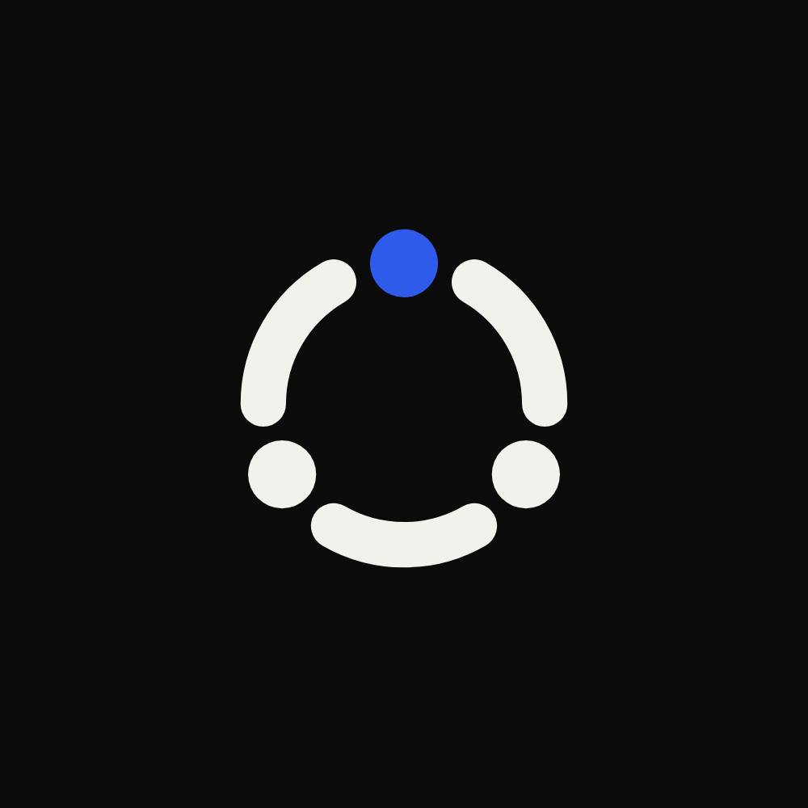

# Run-IQ

**A decision engine for regulated domains.**

[run-iq.io](https://run-iq.io)

Run-IQ applies versioned rules to input data and returns a decision. The engine knows no domain: plugins bring calculation models, and rule packs bring the content (tax, compliance, eligibility, or anything else written as rules).

The same input, rules and engine version always give the same result.

## Where it is going

Run-IQ is being rebuilt around one idea: every decision comes with a proof.

- **Proof.** Each decision records the digest of its input, the rules and versions it used, and how each output was reached.
- **Verify and replay.** Anyone can check a proof, or replay the decision, without trusting the system that produced it.
- **Selective disclosure.** A proof can show one fact of the input and keep the rest private.
- **Packs.** Rules are distributed as signed, versioned packs that experts certify.

The formats are defined in [`spec`](https://github.com/Run-IQ/spec) and implemented in [`core`](https://github.com/Run-IQ/core). Work happens on the `refonte/*` branches; the published packages still carry the previous version.

## Repositories

| Area | Repositories |
|---|---|
| Engine | [`core`](https://github.com/Run-IQ/core), [`spec`](https://github.com/Run-IQ/spec), [`dsl-jsonlogic`](https://github.com/Run-IQ/dsl-jsonlogic) |
| Plugins | [`plugin-sdk`](https://github.com/Run-IQ/plugin-sdk) |
| Orchestration and storage | [`decision-graph`](https://github.com/Run-IQ/decision-graph), [`context-engine`](https://github.com/Run-IQ/context-engine), [`rule-registry`](https://github.com/Run-IQ/rule-registry) |
| Authoring from policy text | [`policy-dsl`](https://github.com/Run-IQ/policy-dsl), [`policy-graph`](https://github.com/Run-IQ/policy-graph), [`policy-bridge`](https://github.com/Run-IQ/policy-bridge) |
| Access | [`cli`](https://github.com/Run-IQ/cli), [`mcp-server`](https://github.com/Run-IQ/mcp-server), [`server`](https://github.com/Run-IQ/server) |
| Tests | [`integration-tests`](https://github.com/Run-IQ/integration-tests) |

## Contact

[contact@run-iq.io](mailto:contact@run-iq.io)
